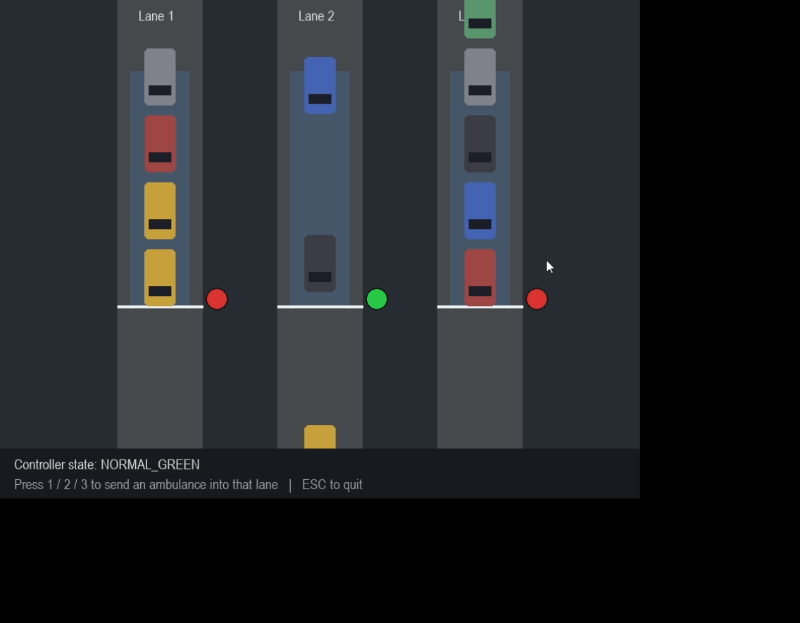

# Ambulance Signal

A prototype that detects an ambulance in a traffic camera feed and gives its lane a green signal, so ambulances don't get stuck at red lights.



## How it works
1. **Detection:** a YOLOv8n model fine-tuned on a Roboflow Universe ambulance dataset finds ambulances in each video frame. A second, standard YOLOv8n model counts normal vehicles.
2. **Lane logic:** an ambulance must be seen for several frames in a row before its lane is marked priority. The lane stays priority for a short time after the ambulance leaves, so one missed frame doesn't flip the signal back.
3. **Signal controller:** a state machine runs the normal green, yellow, red cycle. When a lane is flagged, the current green goes yellow for a minimum time, all lanes go red briefly, and then the ambulance lane turns green. After the ambulance has passed, the normal cycle resumes.
4. **Demo:** `demo.py` is a Pygame simulation of a 3-lane intersection using the same controller. Press 1, 2 or 3 to send an ambulance into a lane.

## Results
On the validation split of the fine-tuned model (ambulance class): mAP50 0.888, precision 0.857, recall 0.875. The dataset is small (about 170 training images), so treat these numbers as a rough guide, not a guarantee.

I also added frames from a traffic video with no ambulance as negative examples, which removed false ambulance detections on that video.

## Run it
```
pip install ultralytics opencv-python pygame
python demo.py            # Pygame simulation
python detect_video.py    # detection on a video (needs traffic.mp4 and best.pt)
python signal_controller.py   # controller self-test
```
The trained model (`best.pt`) and videos are not included in the repo.

## Limitations
- Small training set; it can miss ambulances at a distance or at unusual angles.
- The controller serves one ambulance at a time.
- The Pygame demo simulates the camera; it does not run YOLO.
- This is a learning project, not a safety-certified traffic system.

## Next steps
Siren audio detection, multi-ambulance handling, and a hardware demo with LEDs.

## Credits
Ambulance dataset: [Ambulance Dataset on Roboflow Universe](https://universe.roboflow.com/yeu/ambulance-9pu8m), CC BY 4.0. Model: Ultralytics YOLOv8.